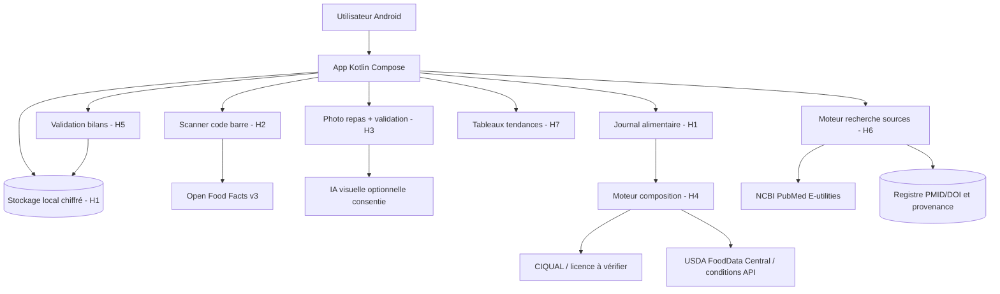

# Vue de contexte / frontières

Toutes les flèches externes sont **DESIGN ONLY** à H0. Données personnelles isolées du registre de publications. L'analyse de photo ne vaut ni mesure précise du grammage ni dosage micronutritionnel.

## Backend futur (option)
API sécurisée/BFF, contrôle de consentement, worker ingestion scientifique, stockage privé isolé, vecteur RAG avec provenance, audit et rate limits. Pas de déploiement cloud ni Kubernetes tant que local-first satisfait le MVP.
